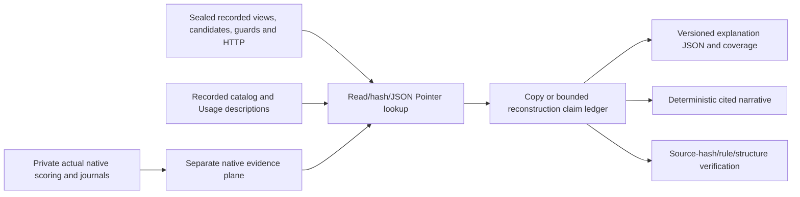

# CALM/1 — trace-grounded explanations, design and evidence boundary

Baseline: `f0f005ccaccc2c54d6fac7eda24986fd48551d08`, frozen finite-usage/1.
CALM is a deterministic **offline, read-only** explanation builder. It does not
participate in candidate selection, authorization, execution or native scoring.
No controller, operator, reasoner, fixture, old evidence or freeze point changes.
“Causal” here means explicitly bounded model-relative explanation plus controlled
fixture interventions, not unrestricted causal identification or hidden-intent inference.

## Evidence audit

| Retained evidence / source | Supported claims | Boundary / unavailable detail |
| --- | --- | --- |
| `execution/worker/input.json` and `discovery.json` | Typed Goal/Thing; declared schema, bindings, reviewed Usages and provenance/hash identity | Declarations are models, not observed behavioral truth |
| `transcript.json` / `result.json`, runtime.py::run | Actual observations presented to reasoner, proposals, goal truth, candidate aggregate applicability/contribution/expected states; structured feedback | No private reasoning chain or proof of mental causation |
| `transcript.view.descriptions` + `view.context.values` | Raw-value replay of explicit Equal/IntRange predicates | Actual runtime per-atom verdicts were not logged. Replay ignores historical freshness and does not reconstruct P's local code evaluation |
| `Runtime.authorize` guard records | AUTHORIZED/STALE_PROPOSAL/NOT_AUTHORIZED/AMBIGUOUS and reobserved context; selected assessment on AUTHORIZED | Veto records do not contain all re-evaluated candidates or a unique failing guard clause. Multiple possible NOT_AUTHORIZED causes cannot be invented |
| Rejected old context vs recorded guard context | Which captured values/revision differ, as a deterministic comparison | Does not identify a minimal sufficient causal subset or exact guard clock |
| `intent-N.json` / `authorized-N.json` | Actual proposal reached synchronization stage | These files serialize **Proposal**, not Permit. Nonce/expiry/goal hash/permit object are unavailable; do not relabel proposal files as permit logs |
| `Runtime.execute` / `http.json` | Recorded parsed HTTP status/body, invocation, subsequent snapshot, aggregate evidence/expected_state/counter/goal/echo checks | Raw wire bytes, individual effect/frame verification logs and dispatch clock are not all retained |
| Recorded guard expected state + invocation before/after/evidence | Deterministic per-target and per-frame comparison reconstruction | Not an independently logged verifier verdict. Insufficient evidence yields UNKNOWN; no conversion of a false evidence flag into a proven false effect |
| `evaluation.json.native`, native stores/journals | Separate independent-code-path native verdict and actual stored transitions/interventions | Not agent-visible observations; separate authoring/blinding are not established. `evaluation.expected` is never explanation evidence |

The two semantic layers remain separate: reviewed RDF meaning and recorded formal
assessment are not LLM reasoning. The default scripted reasoner receives actual
observations/assessments; CALM does not infer missing intermediate proposals from
final native state. P explanations quote actual procedural candidate aggregates;
raw RDF predicate replay is still explicitly only the RDF model, not P instrumentation.

## Structure, provenance and rules

Schema: `experiments/calm_schema.json`, JSON Schema2020-12,
`urn:eswc:calm:explanation:1`, `schema_version="calm/1"`.
Implementation: `experiments/calm.py`. No runtime/fixture/clock/network imports.



There is no edge back to the agent. The CLI refuses an output directory within the
input episode; the pure `build` function returns data and writes nothing. Other
callers must also keep outputs outside sealed inputs. Existing output paths are
refused. Source files remain the authority, not the generated narrative.

An explanation contains:

- `provenance`: hashes of every input file actually read; `verified` only when each
  input matches the supplied raw seal, otherwise explicitly `unsealed`.
- `catalog`, `goal`: references to claims containing recorded grounded definitions.
- `claims`: stable ordered IDs, evidence plane, bounded rule, asserted value and
  exact source file/SHA-256/JSON Pointer inputs.
- `steps`: actual turns/context/goal truth, candidates and alternatives, proposals,
  guard/feedback and context changes. A missing trace gives no invented turns.
- `outcome`: runtime status/verified/dispatches, parsed HTTP evidence, checks and
  before/after; separately reconstructed effect/frame comparisons; separately
  native score/store/journal references.
- `coverage`: per-request-category direct/reconstructed/unavailable/not_applicable.
- `narrative`: fixed templates with claim citations; no free-form generated reason.

Evidence planes: `agent_record`, `reviewed_model`, `runtime_observation`,
`native_evaluation`, `record_translation`, `model_replay`, `record_comparison`.
A copied expected state remains a **prediction** inside a candidate/assessment;
its presence in a trace never promotes it to observation or native truth.

Exactly five postprocessing rules:

| Rule | Meaning |
| --- | --- |
| copy | Exact retained JSON value; source hash and pointer |
| candidate_status | Translate recorded applicability/contribution and TRUE/TRUE eligibility; do not assume eligible alternative was vetoed |
| raw_atom | Equal/IntRange over recorded typed values, strictly Bool≠Int; missing value UNKNOWN; unsupported predicate UNAVAILABLE; no clock check |
| compare | Expected/actual captured value equality, exact type; unavailable value/evidence returns UNKNOWN |
| context_changes | Deterministic differences between captured old and reobserved Thing/revision/mutation/fact vectors |

No effect operator is added, no planning/search/automatic repair, no RDF query with
executable scripts, no arbitrary structural causal model. Postprocessing does not
call the frozen interpreter to recalculate freshness at today's clock. Narrative
says what was proposed, which assessments supported or excluded alternatives and
what the guard/outcomes recorded; it does not assert that association uniquely
identifies the reasoner's internal cause. AUTHORIZED means recorded authorization,
not retrospective proof of correct behavior.

Verification replays source copies/bounded rules, checks hashes/claim links/evidence
planes and compares structured/narrative output with a deterministic rebuild. Schema
validation checks shape. These checks share implementation and are not an independent
semantic oracle; hand-checked tests separately assert UNKNOWN, wrong-effect/frame,
noncontributing alternatives, missing evidence, timeouts and invariance. An attacker
able to rewrite source and seals is outside this evidence-integrity model.

## Coverage definition

Sixteen requested categories per episode: observed context; goal; candidate
aggregates; prediction; selection/abstention; HTTP; native scoring; raw model
preconditions; guard; runtime postconditions; reconstructed frame verification;
actual runtime atomic preconditions; actual permit contents; freshness evaluation
clock; hidden reasoner intent; general causal identification.

A category is **not_applicable** only when its triggering action did not occur,
e.g. runtime postcondition checks for a no-dispatch episode. A missing required
field is **unavailable**, not FALSE or not_applicable. Report direct and reconstructed
coverage separately with all denominators and unavailable counts; do not condition
coverage on goal success. A structured UNAVAILABLE report is honest missing coverage,
not a grounded explanation of a nonexistent fact. Five categories are expected to
remain unavailable under this frozen telemetry: actual per-atom verdicts, permits,
clock, hidden intent and general causal identification.

Greater coverage would need new instrumentation: timestamped per-clause evaluator
and guard reasons, serialized issued/consumed permits and explicit per-frame checks.
Such instrumentation would be a separately versioned runtime change requiring review;
this task deliberately does not instrument or unfreeze finite-usage/1.

## Bounded intervention and noninterference protocol

Prospective `experiments/calm_study.py::plan` defines six interventions in each
controlled domain, with one declared input field changed per baseline/treatment pair:

| Intervention | Room | Cabinet | Predicted difference |
| --- | --- | --- | --- |
| readiness | heaterReady true→false; cooler stays true | actuatorReady true→false | Action→NO_DIRECT_MATCH |
| goal polarity/target | Desired temperature22→20, initial21 fixed | Desired secured true→false, initial unsecured fixed | Heat→Cool; Secure→already-satisfied Finish |
| observation availability | Omit only heater readiness | Omit only actuator readiness | Action→UNKNOWN_CONTEXT; native readiness remains true |
| revision freshness | Revision+1 after first intent, before guard | Generation+1 at same barrier | First AUTHORIZED→STALE_PROPOSAL; reobserve, one eventual authorized action, new CAS value |
| actual effect | Existing native `wrong` mode (+2 instead of+1) | Existing wrong mode leaves latch unchanged | Same initial proposal/prediction; SUCCESS→POSTCONDITION_FAILED |
| alternative membership | Add one conflicting reviewed Usage referring to existing Cool binding | Add one conflicting Usage on Release | Action→AMBIGUOUS, no dispatch |

The extra alternative includes its dependent expression/frame triples; the manipulated
unit is **one candidate definition**, not one RDF triple. It is a deliberately faulty
model claim and test approval, not asserted correct native semantics. Wrong-effect
modes are existing fault mechanisms; no fixture code changes. Revision intervention
changes only its counter, not room temperature or cabinet door. All other native
initial values/goal terms remain fixed. Fresh timestamps/ports/UUIDs are incidental
run metadata, not literal byte-matched causal controls.

The plan is written before worker execution.12 pairs ×2 sides ×2 postprocessing
settings =48 fresh semantic-worker episodes. Both settings run identical frozen
workers; OFF omits CALM, ON invokes it only after execution/scoring. Compare actual
proposals/calls/guards and native before/after/journals with timestamps/UUIDs/timings
removed; hash inputs before/after ON processing. This verifies postprocessing
noninterference by architecture, input immutability and controlled repeats—not a
randomized proof about a future online explainer. No explanation is fed to the agent.

Postprocess all88 existing S/P cross-domain episodes without rerunning that matrix.
Check36 existing identifier/registration/source-order comparisons on semantic
projections: canonical physical bindings, grounded properties/typed values,
assessments, model predicates, goals, guards/outcomes. Preserve IDs/hashes/source
citations in full output; exclude opaque IDs, citation paths and clock/UUID metadata
only in the semantic invariance comparison. No statement that byte reports are equal.

Keep pre-recorded predictions distinct from observed intervention results. Native
scoring uses the unchanged fixture contracts, not generated explanations or benchmark
answer fields. Same-author fixtures, known intervention mechanisms, technical
repeats and a hand-selected finite model do not establish external causal validity.

## Execution/reproduction boundary

```sh
PYTHONPATH=src .venv/bin/python -m experiments.calm \
  --episode docs/artifacts/eswc_aat_cross_domain/run-001/raw/episodes/e001 \
  --seal docs/artifacts/eswc_aat_cross_domain/run-001/raw/sha256.json \
  --output /tmp/calm-one-fresh

PYTHONPATH=src .venv/bin/python -m experiments.calm_study run --output /tmp/calm-study-fresh
PYTHONPATH=src .venv/bin/python -m experiments.calm_study summarize \
  --output docs/artifacts/calm_explanations/run-001
PYTHONPATH=src .venv/bin/python -m unittest discover -s tests/calm -v
```

`calm` is pure postprocessing; `calm_study run` explicitly executes new controlled
interventions. `summarize` validates raw hashes and regenerates summaries only.
Commands require fresh output directories and repository-root execution. The schema
uses existing jsonschema only for validation; the builder itself needs standard
Python JSON/path/hash libraries. No model service or new runtime dependency.
