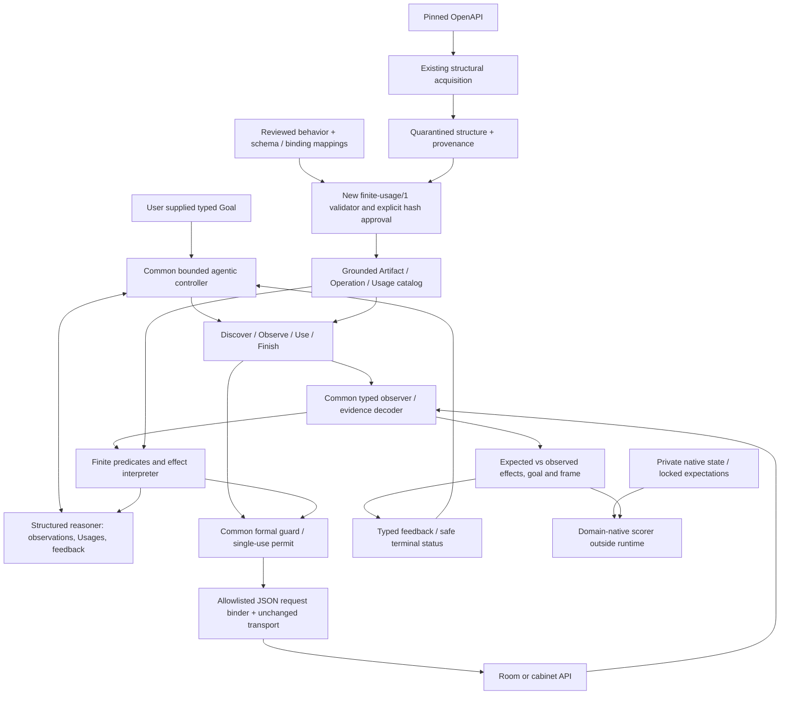

# Reusable finite Usage interpretation profile — design only

Baseline: `ca15110a7f2f6e69988591d6d98b3208fdff78ae`. No runtime, fixture,
ontology, historical report or sealed evidence is modified. Proposed profile:
**`finite-usage/1`**, namespace **`urn:eswc:aat:usage:1#`** (`u:` below).
This is a separately versioned experimental interpretation language, not a revision
of `room-step/1`, a published ontology standard or unrestricted OWL reasoning.

The objective is one controller/interpreter serving two kinds of state/effect:
integer room temperature and Boolean cabinet security. Reusing endpoint discovery
alone does not meet it. The controlled second domain is **same-author feasibility
apparatus**, not an independently developed API or external-generalization result.

## Scientific foundation and current evidence boundary

Retain the original distinctions in `ESWC_AGENTIC_AGENT_ARTIFACT_ARCHITECTURE.md`:
Agent pursues Goal; Artifact represents Thing and exposes Operations; a separate
Usage connects an operation to pre/postcondition Contexts. Actual observations,
expected contexts and desired contexts remain different records. Original report
§§4.1–4.2 ground these concepts; §§5–6 limit what was implemented/proposed.
Typed evaluation, explicit evidence policy, permits and native adjudication are
experimental mechanisms, not features retroactively attributed to the original paper.

At this baseline, `ESWC_AAT_ACQUISITION_TO_EXECUTION_RESULTS.md` establishes the
room-only acquisition→review→admission→unchanged-controller pipeline: four paired
scenarios/eight verified successes, two quarantine controls and one detected wrong-
sidecar execution. It does not establish a reusable interpreter. Earlier architecture,
implementation plan and acquisition/generalization design documents are historical
proposals; statements there that extraction is not implemented are superseded by
acquisition results, not silently rewritten here. This document supersedes neither
historical measured outcomes nor their source identities.

## 1. Specialization audit

Classification: **M** reusable mechanism/authority principle; **P** explicit finite
profile constraint; **D** provider/domain knowledge. A function can combine all three.
A reusable principle is not a claim its current Python function is generic.

| Source / exact entry point | Current assumption | Class | Migration consequence |
| --- | --- | --- | --- |
| `experiments/aat/model.py::NS`, `ROOM`, `StateGoal.__post_init__` | One fixed Thing IRI; integer temperature goal18–26; age0–30s | D identities/range; P goal shape/age bounds | New grounded fact-key/schema/goal records; old records unchanged |
| `model.py::ContextSnapshot`, `Candidate`, `Usage` | Named temperature/heater/cooler/revision/mutations/sentinel fields; predicted_temperature; readiness/bounds/delta-only Usage | D fields; P operators/record shape | Generic typed facts/conditions/effects, no temperature aliases |
| `data/ontology.ttl` | Metamodel classes mixed with temperatureC, heaterReady/coolerReady and RevisionRequest/RoomReply | M conceptual relations; D properties/wire names; P finite rules | Preserve metamodel relations; new separate profile/schema terms and domain property IRIs |
| `rdf.py::load` resource/seen/hash checks | Typed named links, same grounded pre/post subject, complete consumed-triple set, reviewed flag and external graph hash | M | Reuse algorithm/obligations; write new closed loader; no arbitrary extra triples accepted |
| `rdf.py::load` cardinality/binding checks | Exactly one specific room Thing/artifact, two POSTs /heat,/cool and /state observer | D paths/Thing; P counts/verbs | New bounded catalog, declarative binding roles and observation mapping |
| `rdf.py::load` conditions/effects/frame | Two readiness predicates,18–26, addInteger±1, revision/mutation+1 and exact three-property frame | D predicates/ranges; P arithmetic/counter/frame contract | General typed predicates, two effect operators and complete per-schema frame partition |
| `runtime.py::definitions` | Procedural branch dispatches Python knowledge by /heat and /cool | D | Keep old baseline; add explicitly measured local knowledge for each new-profile domain |
| `runtime.py::candidates` | Ready Boolean by two fixed IRIs; temperature bounds; prediction T+delta and goal equality | D accesses; P one-step reasoning; M applicability vs goal relevance and UNKNOWN | New finite interpreter; retain single-step strategy |
| `runtime.py::fresh`, `complete` | Generic age check but completeness explicitly temperature/revision/mutations/sentinel | M freshness principle; D completeness fields | Schema-driven required evidence; reuse timestamp primitive |
| `runtime.py::ScriptedReasoner.propose` | Discover/Observe/eligible candidate proposal, but direct temperature goal test and old completeness call | M strategy; D actual field accesses | New thin reasoner using generic goal verdict, same proposal contract/decision strategy |
| `Runtime.observe`, `serialize_contexts` | One /state request; fixed JSON keys, ROOM-oriented context/goal triples | D parsing/schema; M raw evidence and actual/desired separation | Declarative pointers plus new typed snapshot serializer |
| `Runtime.authorize` | Reobserve; compare selected fixed fields/revision; require applicable and contributing | M authority; D comparison tuple; P whole-Thing revision | Generic dependency/frame evidence comparison; same fail-closed principle |
| `Runtime.execute` | Body expected_revision; response exactly revision/temperature; T+delta; fixed frame tuple | D wire keys/fields; P JSON and exact counter protocol; M actual-vs-expected verification | Versioned JSON binder and generic frame/effect verifier |
| `Runtime.run` | Bounded typed tool loop/feedback, one dispatch and safe terminal failure; Finish directly reads temperature | M lifecycle; D Finish implementation | Extract strategy in new runtime; cannot reuse whole method byte-for-byte |
| `model.py::Permit`, `Runtime.issued` | Nonce, handle, revision, graph hash, single consumption; expiry implicit via snapshot freshness | M; P integer revision | Keep concept, bind goal/schema/binding hashes and explicit evidence expiry in new permit |
| `semantic_action.oracle.current` | Timestamp freshness, no future timestamp, optional since check | M | Reuse unchanged for supported ISO time evidence; not calendar `oracle.verify` |
| `semantic_action.transport.HTTPTransport._http_request` | 127.0.0.1 HTTP origin, JSON object reply, no redirects,5s timeout | M transport; P restricted protocol/environment | Reuse unchanged; new caller allowlists GET/POST/PUT, no204/text/auth expansion |
| `native.py::Room`, `serve`, `score` | Physical ±1 rules, readiness/range and field names, atomic revision, native journal and thermal oracle | D apparatus; M atomicity/scoring method | Reuse existing room service/scorer privately; cabinet needs own native implementation/scorer |
| `completion.py::FIELDS`, `REQUEST`, `REPLY`, `STATE`, `complete`, `admit` | Exact room wire schema/field projection; provenance re-extraction and explicit graph/input approval | D schema/mapping; M provenance/admission | Keep room completion intact; a new-profile completion validator must reconcile new bindings/schemas |
| `study.py`, `completion_study.py::episode` | Fixed22 target, room fixture/cases/scorer and intervention | D | New small cross-domain driver; old results/driver unchanged |

Tests supporting this audit: `tests/aat/test_agent_artifact.py` (guard veto,
Finish, permits, actual flip); `test_validity.py` (15 rejected semantic mutations,
readiness fallback and six identifier/order executions); `test_acquisition.py`
(structural quarantine/provenance/dialects); `test_completion.py` (binding meaning,
forged inputs, explicit approval, reconsideration and false-effect detection).
These are existing evidence, not tests of the proposed new profile.

## 2. Selected domains and smallest scope

| Dimension | Room (existing controlled fixture) | Cabinet latch (proposed controlled fixture) |
| --- | --- | --- |
| Thing | Virtual thermal room | Secured storage enclosure |
| Domain facts | Integer temperature in Celsius; heater/cooler Boolean readiness | Boolean secured, doorClosed and actuatorReady |
| Operations | POST /heat, POST /cool | PUT /cabinet/secure, PUT /cabinet/release |
| Observations | GET /state, flat JSON | GET /cabinet/status, nested JSON |
| Primary effect | Temperature +1 or −1 | Assign secured true or false; not integer arithmetic |
| Goals | temperature=22 | secured=true AND doorClosed=true, or secured=false AND doorClosed=true |
| Applicability | Reviewed readiness and numeric interval | actuatorReady=true AND doorClosed=true; both assignments can be applicable |
| Frame | Both readiness values and unrelated sentinel JSON | doorClosed, actuatorReady and unrelated inventory/marker JSON |
| CAS / evidence | Existing integer revision/mutations/timestamp | Proposed integer generation/writes/timestamp with different nested wire keys |

Cabinet operations assign their documented Boolean and increment generation/writes
exactly once for an accepted operation, including assignment of an already held value.
The controller must avoid such unnecessary calls when the goal already holds.
Reject invalid body400, revision mismatch409 and non-ready/open-door operation422
without state change. Native journal records these outcomes. Proposed body is
`{"guard":{"generation":N}}`; replies contain `receipt.generation` and
`latch.secured`. Status reads include `identity`, `evidence.time`, `latch`,
`interlocks` and `audit` fields. Exact JSON keys are provider configuration, not
interpreter branches. This fixture and its source/native truth do not yet exist.

No suitable independent API with compatible observation, atomic mutation and reset
is established by the repository evidence. Petstore is an independently authored
**documentation** example without these demonstrated semantics; Radicale is the
preserved incompatible CalDAV result. Neither is nominated as this experiment's
second executable domain. No new provider search was performed. Select the cabinet
feasibility fixture explicitly; replacing it later with an external API requires
separate eligibility/native checks, not a retrospective external-validity label.

## 3. Proposed architecture and interfaces



Logical interfaces, not a request for one class/module each:

```text
FactKey = (thing_iri, property_iri)
Slot = (key, strict_type, unit_or_none, allowed_bounds_or_none, observation_pointer)
Fact = (key, value_or_UNKNOWN, raw_evidence_ref, observed_at, source_revision)
Snapshot = (id, artifact, immutable_facts, revision, mutation_count,
            evidence_clock, received_at, source_hashes)
Goal = (id, grounded_thing, all_equal_terms, max_age_seconds)
Usage = (id, artifact, operation, pre_context, effect_context, frame_slots, review_hash)
View = (goal, discovered, actual_context, descriptions, assessments,
        goal_verdict, evidence_complete, structured_feedback)
Reasoner.propose(View) -> Proposal(tool, handle?, snapshot_ref?)
assess(Goal, Snapshot, Usages) -> Candidates(pre_truth, predicted_goal_truth,
                                         expected_context, frame_truth, reasons)
authorize(Proposal, Goal, reobserved Snapshot) -> Permit | Feedback
verify(Goal, Usage, before, HTTP_result, after) -> separated truth verdicts
```

Keep immutable records, bounded local catalogs and ordinary functions. A Slot is a
schema declaration, not a live fact. A Usage predicts an **expected** Context; it
never overwrites an observed ContextSnapshot. Agent goals are supplied, not formed
autonomously. Reasoner receives actual evidence and validated descriptions/assessments;
it chooses a Usage, never a raw URL/body or an oracle-provided expected answer.

## 4. Finite typed semantics

One Usage mutates one Thing; a catalog may contain both domains. Grounding is exact
IRI equality, without name matching, subclass inference or owl:sameAs. Initial
limits proposed: at most8 artifacts,8 action bindings/artifact,32 domain slots/Thing,
16 conjuncts/Context,4 effect targets/Usage, strict integer range within signed32-bit,
1MiB graph/JSON input and depth32. Metadata revision/mutation integers must be
nonnegative and bounded; overflow is unsupported, never wrapped. These are proposed
limits requiring implementation tests, not current capabilities.

Schema FactKeys must be unique; duplicate/ambiguous slot definitions reject admission.
Domain slot types: `Int` (strict integer, Python bool excluded) and `Bool`. A third
**OpaqueJSON** type exists only for frame equality; it accepts bounded null/bool/int/
string/array/object trees, rejects floats/nonfinite numbers/duplicate keys, compares
object keys without order and arrays with order. No arithmetic or goal predicate
on opaque JSON. Int properties carry an explicit unit IRI; room uses Celsius,
protocol counters count. No implicit string/float/Boolean/numeric/unit conversion.

| Construct | Definition | Required domains / boundary |
| --- | --- | --- |
| `Equal(slot, typed literal)` | TRUE iff a fresh known value has the exact declared type/unit and equals literal; FALSE for known unequal compatible value | Int room goals and readiness; Bool cabinet goals/readiness |
| `IntRange(slot, lo, hi)` | Inclusive lo≤x≤hi, strict Int and matching unit, lo≤hi | Room applicability18..25 and19..26 only; not applied to Bool |
| `All(conditions)` | FALSE if any FALSE; TRUE if all TRUE; otherwise UNKNOWN. Empty conjunction rejected | Goal and precondition contexts; maximum16 terms; no OR/NOT/quantification |
| `AddInt(slot, delta)` | Expected x′=x+delta from the **before** snapshot; delta only−1 or+1, same unit; validate declared bounds/overflow | Heating/cooling; never Boolean arithmetic |
| `SetBool(slot, value)` | Expected x′=the explicit Bool literal; no coercion or implicit toggle | Cabinet secure/release; no inferred opposite/name-based behavior |

Goals are nonempty conjunctions of Equal over one grounded Thing. Preconditions
are nonempty All of Equal/IntRange. Unsupported operators/types/predicates, malformed
grounding, duplicate/conflicting writes and invalid frames reject at admission;
they do **not** become another supported operator or FALSE facts. Missing, stale,
wrong-subject, ill-typed or contradictory runtime evidence is UNKNOWN with reason,
never proof that a precondition is false/true. A syntactically valid FALSE predicate
is distinct from unavailable evidence. Missing facts do not use RDF closed-world
negation. Present explicit false Boolean is a known value.

Prediction evaluates all effects simultaneously against the same immutable before
snapshot. At most one write per slot. Unwritten slot values propagate **only** under
explicit frame assertions and available evidence; no silent inertia. Predicted
states are labeled EXPECTED. Candidate contributes only when predicted full goal is
TRUE; no approximate numeric progress, recursive search, action chains or repair.
For20→22 with only±1, return NO_DIRECT_MATCH, not unreachable-goal proof.

All declared domain slots must partition into effect targets and frame slots,
with no overlap, omissions or duplicate declarations. Before values for all slots
must be available/fresh before dispatch, including written slots. Frame asserts
exact equality before/after, not merely schema validity. Outside declared observable
state, native scoring must check private unrelated records; runtime cannot prove
unobserved-world preservation. Goal/condition/effect/frame references must share the
Usage's Thing; artifact/operation ownership is checked separately.

Revision/mutation counters are protocol metadata, not unconstrained domain effects.
Initial profile requires whole-Thing integer CAS and exactly+1 revision/+1 mutation
count per successful mutating invocation. Their observation/body/response pointers
are declared; a client cannot supply the expected revision. No effect may target
metadata, timestamps, mappings, schema or review status. A provider lacking this
atomic protocol is unsupported for this first profile; do not emulate it with an
unproven client-side race check.

### Evidence, authorization and verification

One approved observation GET yields a coherent snapshot. Declare pointer/type for
Thing identity, timestamp, revision, mutation count and every domain slot. Snapshot
metadata and values must have the same observed revision. Reuse `oracle.current`
for0≤age≤goal.max_age, reject future stamps; post-execution evidence additionally
must not predate dispatch. Local receive time is retained but cannot establish
server freshness/atomicity. Clock trust/coherence needs native review; a JSON schema
alone cannot establish it. Missing identity/version/timestamp blocks authorization.

Reobserve before authorization. Any changed revision or relevant value yields
STALE_PROPOSAL and invalidates intent, even if the new state might still support
that action. The reasoner must Observe/reconsider. UNKNOWN/FALSE applicability,
unknown frame evidence or non-TRUE predicted goal cannot receive a permit. Permit
binds nonce, goal/Usage/schema/binding/approval hashes, artifact/Thing, snapshot,
revision and expiry; one dispatch only. Atomic CAS closes the final race.

After dispatch compare actual typed effects, explicit frame, protocol increments,
response revision/declared echo fields, freshness and actual goal. Return each
verdict separately: HTTP success, effect truth, frame truth, goal truth and evidence
sufficiency. FALSE is detected mismatch; UNKNOWN is insufficient verification.
Neither is SUCCESS. Finish independently reobserves before reporting verified
satisfaction, including already-satisfied goals. With no dispatch it requires fresh
goal facts/identity/protocol evidence and stable goal snapshot, not proof of every
action's readiness; following dispatch it also requires the complete successful
effect/frame verification. Neither path accepts an UNKNOWN goal. Timeout/transport-uncertain outcomes
stop all further mutation attempts; settle/observe boundedly and retain late state.
Known409 is rejected without new action in this initial one-dispatch budget.

Initial JSON binding subset: read GET, mutate POST or PUT, static allowlisted relative
paths and public approved loopback origin; JSON object responses only. Declarative
JSON Pointers (bounded, local, no wildcards) map observations/echoes and one reserved
revision leaf in a static body template. The only dynamic request value is permit
revision; no expressions/scripts or arbitrary goal-to-payload synthesis. Pointers,
constants, schema and methods are reconciled against extracted structure and reviewed
native contract. No custom-code plugins, headers/auth,204-only responses, multipart,
CalDAV, remote import or arbitrary code in RDF. Existing HTTP transport can be reused;
new binder/decoder must enforce this subset and limit response/body sizes.

### Identifier-independent physical choice

With one eligible physical binding, preserve the current scripted strategy: discover,
observe, Finish if verified goal, otherwise propose the eligible goal-establishing
Usage; on stale feedback reobserve; stop on failure/uncertainty/budget. No domain
labels/property-name branches are permitted. Lexical handle selection may still
choose an alias of the **same** reviewed binding/effects, changing only trace IDs.

Current min(handle) tie-break is not invariant for two different eligible physical
operations. Proposed new-profile guard therefore **abstains on multiple distinct
eligible bindings**, or conflicting simultaneous semantics for one binding. This is
an explicit versioned ambiguity constraint, not a claim the old guard already does
it. Binding identity includes origin/method/path/static body and revision mapping;
consistent aliases may share one physical action. No priority/rank vocabulary is
added to force a preferred provider. Core cases have unique eligible physical
operations; separate ambiguity tests must reject instead of making ID-sensitive
physical choices. The policy/guard implementation change is counted in initial
migration and then frozen identically for both domains.

## 5. Ontology delta and example Usages

Retain existing `aa:Agent/Thing/Artifact/Operation/Usage/Goal/ContextTemplate` and
`aa:represents/hasOperation/forArtifact/forOperation/hasPrecond/hasPostcond/subject`
as explicit conceptual types/relations; no new entailment rules. New `u:` terms:

| New terms | Interpretation |
| --- | --- |
| Slot; property, datatype, unit, domainMinimum/domainMaximum | Grounded typed schema entry; property name is opaque to evaluator |
| all, Equal, IntRange, onSlot, value, lower, upper | Finite conditions in Contexts |
| effect, AddInt, SetBool | Finite expected-state transformer nodes |
| frameSlot | Complete domain-slot frame list on Usage |
| observationBinding, Binding, method, path, mediaType, pointer, slotMapping | Reviewed wire projection, reconciled from structure |
| revisionPointer, mutationPointer, timestampPointer, thingPointer, requestRevisionPointer, replyRevisionPointer | Coherent evidence/CAS protocol mapping |
| bodyTemplate, successStatus, echoMapping | Static JSON payload and declared response checks, no execution code |
| profile, reviewRecord, schemaRef, bindingRef, evidenceRef | Version/admission/provenance links; review stays separately hash-bound |

Typed snapshots/goals need new serializers. Domain terms (e.g. `r:temperature`,
`c:secured`) are graph data, not additions to `room-step/1` or frozen vocabularies.
Structural `urn:eswc:aat:structure:1#` remains acquisition output; a new completion
validator projects supported facts, preserves assertion provenance and demands
review/hash approval. Structural GET discovery never creates Usages or confirms
sensor meanings. Existing room completion remains unchanged and incompatible.

The following **proposed RDF syntax examples** show complete behavioral templates
for four Usages, with abbreviated wire declarations/review metadata deliberately
omitted. They are not admissible manifests or input to the old loader. Every named
slot/binding/owner needs validated schema/evidence/provenance in an actual catalog;
syntax validation alone is not profile or behavioral validation.

```turtle
@prefix aa: <urn:eswc:aat:prototype:1#> .
@prefix u: <urn:eswc:aat:usage:1#> .
@prefix r: <urn:example:room:> .
@prefix c: <urn:example:cabinet:> .
@prefix xsd: <http://www.w3.org/2001/XMLSchema#> .
r:thing a aa:Thing .
r:artifact a aa:Artifact ; aa:represents r:thing ; aa:hasOperation r:opA, r:opB .
r:opA a aa:Operation . r:opB a aa:Operation .
r:t a u:Slot ; aa:subject r:thing ; u:property r:temperature ;
    u:datatype xsd:integer ; u:unit r:Celsius ; u:domainMinimum 18 ; u:domainMaximum 26 .
r:h a u:Slot ; aa:subject r:thing ; u:property r:heaterReady ; u:datatype xsd:boolean .
r:k a u:Slot ; aa:subject r:thing ; u:property r:coolerReady ; u:datatype xsd:boolean .
r:s a u:Slot ; aa:subject r:thing ; u:property r:sentinels ; u:datatype u:OpaqueJSON .
r:uA a aa:Usage ; u:profile "finite-usage/1" ; aa:forArtifact r:artifact ; aa:forOperation r:opA ;
    aa:hasPrecond r:preA ; aa:hasPostcond r:postA ; u:frameSlot r:h, r:k, r:s .
r:preA a aa:ContextTemplate ; aa:subject r:thing ;
    u:all [ a u:Equal ; u:onSlot r:h ; u:value true ],
          [ a u:IntRange ; u:onSlot r:t ; u:lower 18 ; u:upper 25 ; u:unit r:Celsius ] .
r:postA a aa:ContextTemplate ; aa:subject r:thing ;
    u:effect [ a u:AddInt ; u:onSlot r:t ; u:value 1 ; u:unit r:Celsius ] .
r:uB a aa:Usage ; u:profile "finite-usage/1" ; aa:forArtifact r:artifact ; aa:forOperation r:opB ;
    aa:hasPrecond r:preB ; aa:hasPostcond r:postB ; u:frameSlot r:h, r:k, r:s .
r:preB a aa:ContextTemplate ; aa:subject r:thing ;
    u:all [ a u:Equal ; u:onSlot r:k ; u:value true ],
          [ a u:IntRange ; u:onSlot r:t ; u:lower 19 ; u:upper 26 ; u:unit r:Celsius ] .
r:postB a aa:ContextTemplate ; aa:subject r:thing ;
    u:effect [ a u:AddInt ; u:onSlot r:t ; u:value -1 ; u:unit r:Celsius ] .
r:goal a aa:Goal ; aa:subject r:thing ;
    u:all [ a u:Equal ; u:onSlot r:t ; u:value 22 ; u:unit r:Celsius ] .

c:thing a aa:Thing .
c:artifact a aa:Artifact ; aa:represents c:thing ; aa:hasOperation c:opA, c:opB .
c:opA a aa:Operation . c:opB a aa:Operation .
c:l a u:Slot ; aa:subject c:thing ; u:property c:secured ; u:datatype xsd:boolean .
c:d a u:Slot ; aa:subject c:thing ; u:property c:doorClosed ; u:datatype xsd:boolean .
c:p a u:Slot ; aa:subject c:thing ; u:property c:actuatorReady ; u:datatype xsd:boolean .
c:s a u:Slot ; aa:subject c:thing ; u:property c:unrelatedInventory ; u:datatype u:OpaqueJSON .
c:ready a aa:ContextTemplate ; aa:subject c:thing ;
    u:all [ a u:Equal ; u:onSlot c:p ; u:value true ],
          [ a u:Equal ; u:onSlot c:d ; u:value true ] .
c:uA a aa:Usage ; u:profile "finite-usage/1" ; aa:forArtifact c:artifact ; aa:forOperation c:opA ;
    aa:hasPrecond c:ready ; aa:hasPostcond c:postA ; u:frameSlot c:d, c:p, c:s .
c:postA a aa:ContextTemplate ; aa:subject c:thing ;
    u:effect [ a u:SetBool ; u:onSlot c:l ; u:value true ] .
c:uB a aa:Usage ; u:profile "finite-usage/1" ; aa:forArtifact c:artifact ; aa:forOperation c:opB ;
    aa:hasPrecond c:ready ; aa:hasPostcond c:postB ; u:frameSlot c:d, c:p, c:s .
c:postB a aa:ContextTemplate ; aa:subject c:thing ;
    u:effect [ a u:SetBool ; u:onSlot c:l ; u:value false ] .
c:goal a aa:Goal ; aa:subject c:thing ;
    u:all [ a u:Equal ; u:onSlot c:l ; u:value true ],
          [ a u:Equal ; u:onSlot c:d ; u:value true ] .
```

Anonymous condition/effect nodes above are syntax sugar for local, scoped expression
nodes; only finite acyclic expression trees are accepted, never anonymous owners,
Things or operations. Canonical traversal must ignore blank-node labels. If named
expression nodes are chosen in implementation instead, that is a representation
choice to lock before evaluation, not a domain-specific semantic change.

## 6. Compatibility and migration boundary

| Runtime/profile pairing | Existing room graph | Migrated generic room graph | Proposed cabinet graph |
| --- | --- | --- | --- |
| Existing room-step/1 loader/runtime | Executable, historically tested | Reject; new predicates/profile | Reject; incompatible types/bindings |
| Proposed finite-usage/1 | No implicit import; explicit migration/review needed | Intended support, not implemented/tested yet | Intended support, not implemented/tested yet |
| Existing structural extractor | Structure only, not executable admission | Can supply supported structure; new completion needed | Supported-subset structure expected, concrete document/gate still pending |

| Component | Reuse unchanged? | Precisely what changes |
| --- | --- | --- |
| Old room runtime/graphs/loader/native evidence | Preserve exactly | New module dispatches a different profile; no retrofit or runtime alias pretending old goals are generic |
| Controller observe→reason→guard→act→observe→verify→Finish strategy | Yes, strategy | New `runtime.py` replaces room field accesses with profile services; old `Runtime.run` cannot be called byte-for-byte |
| `Reasoner.propose(view)` and `Proposal(tool,handle,snapshot_ref)` tool contract | Preserve callable/proposal shape; Proposal record may be imported unchanged | New View/Goal/Snapshot types; old static ControllerView type is not compatible without a new version |
| Scripted selection | Preserve unique-match strategy and feedback routing | Generic goal/completeness queries; ambiguity gate explicitly new, then policy frozen for both domains |
| Guard authority/fail-closed/one-dispatch policy | Preserve principles | New dependency set, hash-bound goal/schema/binding/expiry and ambiguity constraint; not old function reuse |
| Feedback code/reasons/context and tool verbs | Preserve protocol shape and terminal meaning | Generic context payload; extra reason/status detail for UNKNOWN/mismatch/ambiguity; no reinterpretation of old results |
| Truth/time/HTTP transport/process supervision | Yes, within restrictions above | Use existing neutral primitives; no new HTTP client/model framework |
| RDF record loader/interpreter/observer/verifier/body binder | No | New separately versioned implementations; generic over schema, no temperature/secured field switches |
| Existing OpenAPI structural extractor | Yes for supported structures | New profile-specific completion/admission mapping and reviewed annotations required; old room completion not rewritten |
| Native scoring method | Preserve independence of answer path | Keep room scorer for room, new cabinet-native scorer from fixture contract; not same oracle implementation |
| Procedural comparison | Preserve equally informed strategy, not implementation | Two API-local knowledge modules; shared loop/guard/evidence/native gate clearly disclosed |

Suggested future package is at most `experiments/aat_reusable/{profile,runtime,study}.py`:
records/loader/interpreter in profile; observer/binder/guard/verifier/reasoner/loop in
runtime; private driver in study. Add a cabinet native fixture and separate native
scorer plus two small local baseline knowledge modules only where needed. These
are proposed file boundaries, not code created here. No plugin/service framework,
remote registry, new planner or mandatory external model.

Freeze common code **after** migration/operator tests and before adding cabinet
bindings to execution. Thereafter both domains run the identical code hash. Zero
cabinet-onboarding edits to that code is a prospective criterion, not a current
measurement. Count initial generic refactoring separately; never relabel it as zero
cost or claim unchanged source relative to `ca15110`.

## 7. Smallest stages and open decisions

1. Review this profile/second-fixture choice, ambiguity rule, frame/counter constraints
   and evidence bounds. Lock exact field-level wire specs and independent native cases.
2. Implement/test two typed effects, conditions, frame partition and generic evidence
   records in a **new** package; keep old AAT31-test suite/evidence as regressions.
3. Migrate bounded loop/guard into one generic runtime, test room via data-only new
   description; pin shared source and operator vocabulary before cabinet onboarding.
4. Build cabinet native contract/gate first, then bindings/reviewed Usages; count
   every domain-specific file/edit and any shared-code change.
5. Run the discriminating protocol in `ESWC_AAT_CROSS_DOMAIN_EVALUATION_PROTOCOL.md`;
   retain failures/partial runs. If an unsupported requirement needs generic edits,
   record a failed zero-change reuse attempt before a separately versioned repair/run.

Decisions pending investigator review: controlled vs later independent second domain;
acceptance of SetBool plus AddInt as sufficient initial operator set; whole-Thing CAS
restriction; explicit-frame completeness and OpaqueJSON policy; ambiguity abstention;
new generic-controller migration vs literal source-reuse wording; exact limits;
reviewer/operator roles and shared-author truth risks. Nothing here authorizes
implementation, unsealing, a provider search or a scientific freeze.
