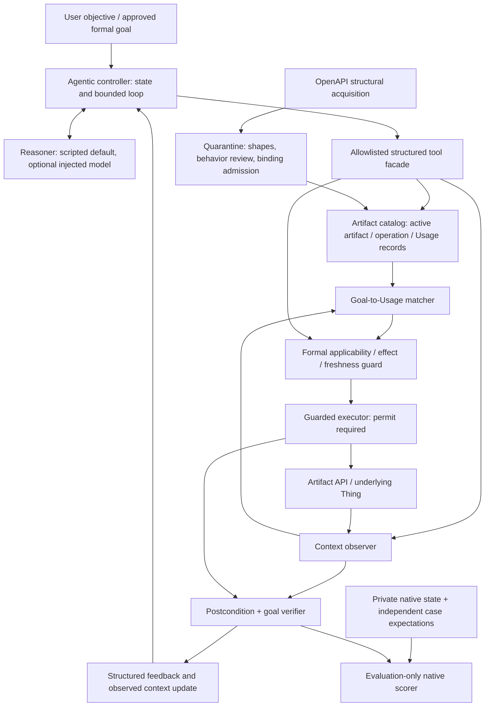

# Agentic Agent–Artifact architecture — proposed, not implemented

Design reference: `297861ae8d7056cd9fbf3c210c5a747cc633027d`. No frozen V3/V4,
tutorial or historical evidence is changed. The target is an operational
Agent–Artifact–Thing/Usage model inside an observe–reason–act–observe controller,
not another API/serialization comparison. The first implementation is a bounded
research demonstration, not an open-ended planning or ontology-reasoning platform.

## Foundation and original implementation boundary

Alaa Daoud's *Semantic Web Environments for MAS* (2018 internship report,
<https://arxiv.org/abs/2003.02054v1>) is the original source identified by the
project protocol. Its full-text version and checksum, tutorial wiki version,
source/test references and attribution limits are recorded in
`ESWC_AGENT_ARTIFACT_MODEL_AUDIT.md`.

- §§3.2.1,4: proactive goal-oriented Agent vs non-autonomous Artifact; AAT extends
  the A&A account and separates agent decision-making from device representation.
- §4.1: generic artifacts expose observable properties/events and operations from
  Thing Descriptions, with protocol/payload bindings. A Thing is the underlying
  physical/virtual entity, not the agent or its desired state.
- §4.2: Usage ties an operation/artifact to pre/postcondition Contexts. Goal is a
  desired Context; choose usages using current context and goal-relevant effects.
- §5 explicitly limits its proof of concept. §5.1 reports Java/JaCaMo/CArtAgO/Jena
  generic-artifact execution and a named SOS-light plan. It acknowledges dependence
  on familiar artifact/operation names. §5.2 reports a Usage ontology and explains
  goal-context lookup. This is not proof of a complete autonomous planner.
- §6.1 discusses grounding the same artifact instance across pre/postconditions;
  §6.2 proposes successive context prediction and search, leaving algorithm choice
  open. Neither a complete general planner nor independent native verification
  should be attributed to that implementation. Heating/cooling motivation appears
  in §2.2; the numeric demonstration below is our proposed apparatus.

The tutorial `agent.py::react_agent` and wiki `02Reactloop.org` provide the
reason→tool→observation→reason pattern; `03Mas.org` provides role/shared-state
orchestration. Neither supplies formal Usage validity. V3 supplies finite calendar
semantics; V4 intentionally removes them. `experiments/goal_choice.py` now shows
bounded context-sensitive selection, but only for grounded EventCreation variants,
without a tutorial-style replaceable reasoner or general Usage representation.
Its 22-episode parity result remains valid within that scope.

## Target concepts, relations and minimal records

All interfaces/types below are **new design contracts**, not existing APIs. Use
plain immutable records and functions in a small experiment, not a class hierarchy
or one module per component. New RDF profile is a separately versioned experimental
namespace, e.g. `urn:eswc:aat:prototype:1#`; it does not extend/overwrite frozen
`sam` or V4 vocabulary files or pretend to be a published standard.

| Original concept / relation | Operational representation and responsibility |
| --- | --- |
| Agent pursues Goal | Controller owns `AgentState(goal, context_refs, transcript, outstanding_proposal, budgets, status)`; user supplies/approves formal objective. No autonomous goal formation. |
| Goal is desired Context | `StateGoal(id, required_ground_facts, invariants, profile_id, max_age)`; distinguish desired facts from observed facts. First profile accepts one room temperature equality plus explicit frame invariants. |
| Artifact represents Thing | `Artifact(id, thing_id, operation_ids, observation_bindings, provenance)`; resource, not decision-maker. Thing may be a controlled virtual room. |
| Artifact has Operation | `Operation(id, artifact_id, method, path, input_schema, output_schema, media_types, binding_version)` describes callable interface only. An operation name is not a behavior model. |
| Usage forArtifact / forOperation | `Usage(id, artifact_id, operation_id, pre_context, post_template, frame, profile_id, review_ref, version_hash)` describes how an operation is useful under a context. Keep Usage ID separate from Operation ID; one operation can in principle have different usages, though the first demo needs two. |
| Context / Status | `ContextSnapshot(id, ground_facts, evidence_refs, observed_at, source_revision)`; observations retain raw payload/provenance. Forecast contexts are explicitly marked EXPECTED, never inserted as sensor facts. |
| hasPrecond / hasPostcond | Typed finite predicates and successor templates grounded to the same subject IRIs; evaluator returns TRUE/FALSE/UNKNOWN and reasons, not arbitrary executable graph text. |
| Usage discovery/selection | Catalog finds registered artifacts/usages; matcher evaluates goal relevance against current facts. Controller/reasoner proposes; formal guard authorizes. |
| Execution / feedback | Invocation, fresh observations, checked postconditions/goal, and structured feedback become the next controller state. HTTP success is only an invocation fact. |

Preserve the conceptual relationships of the report's Usage ontology
(`Usage`, `hasPrecond`, `hasPostcond`, `forArtifact`, `forOperation`). Mapping to
new record fields is explicit; new operational properties such as evidence age,
review status and permits are **extensions**, not claims about the original OWL
ontology. Do not invent `owl:sameAs` mappings or ontology entailment. The new
RDF schema must distinguish Agent/Goal/Context from Artifact/Operation/Usage,
validate every link, and ground pre/post subjects consistently (§6.1 concern).

## Component and authority diagram



There is **no** Reasoner→HTTP or Reasoner→native-storage path. The scorer's data
is not controller context. The diagram distinguishes runtime verification from
benchmark adjudication; common authorship/shared helper risks remain disclosed.
A diagram is not a security sandbox against arbitrary host Python code.

## Precise functional interfaces

The names below specify boundaries; implementation can be ordinary functions.

```text
Reasoner.propose(ControllerView) -> ToolProposal
ToolProposal = Discover(filter) | Observe(artifact_ids) |
               Use(usage_id, bindings, snapshot_ref) | Finish(message) | Clarify(question)

Catalog.discover(filter) -> tuple[ArtifactSummary, ...]
Catalog.usages(artifact_ids) -> tuple[RegisteredUsage, ...]
Observer.observe(artifact_ids, after=None) -> ContextSnapshot | ObservationFailure
Matcher.candidates(StateGoal, ContextSnapshot, usages) -> tuple[CandidateAssessment, ...]
Evaluator.check_pre(Usage, bindings, ContextSnapshot) -> Conditions[Truth, reason, evidence_ref]
Evaluator.predict(Usage, bindings, ContextSnapshot) -> ExpectedContext | Unsupported
Guard.authorize(StateGoal, usage_id, bindings, snapshot_ref) -> Permit | Feedback
Executor.execute(Permit) -> InvocationResult
Verifier.verify(StateGoal, Usage, before, invocation, after) -> VerificationResult
NativeScorer.score(case_expectation, raw_before, raw_after, native_journal) -> NativeVerdict
```

`CandidateAssessment` includes grounded artifact/operation/usage identity,
precondition verdicts, predicted post-state, goal contribution, frame compatibility
and reasons. First matcher accepts only an explicitly supported one-step effect
that meets the goal, not an unexplained LLM confidence score. Unknown predicates/expressions yield UNSUPPORTED, not guessed truth. No candidate means
**NO_DIRECT_MATCH**, not proof that a multi-step goal is impossible.

`Permit` binds approved goal/Usage version hashes, grounded inputs, observation
revision, expiry and allowed operation. Only the guard constructs it. The executor
resolves the reviewed binding internally; model outputs cannot supply URLs, HTTP
methods, arbitrary code or permissions. Reobserve immediately before authorization;
reject stale snapshots, noncontributing effects, missing facts and changed manifests.
UNKNOWN never becomes TRUE. A snapshot must cover all goal/frame-relevant facts;
missing observations are not negative facts. In the demonstration an atomic server-side expected-
revision check also closes the remaining observation-to-mutation race.

`InvocationResult` separates dispatch, status, body/error and uncertain remote
outcome. `VerificationResult` separates modeled-effect conformance, goal satisfaction,
frame preservation and evidence sufficiency. FALSE is not UNKNOWN; an unobserved
mutation cannot be classified as safely absent. A timeout ends mutation attempts
until independent bounded observation/terminal reporting; no speculative alternate.

`Feedback` is typed: code, constraint, FALSE/UNKNOWN verdict, evidence references,
new context reference and allowed next step (observe/clarify/reconsider/stop).
An LLM cannot rewrite it. `Finish` yields SUCCESS only after verified goal truth;
otherwise it can produce an honest blocked/failed/unknown report, not bypass checks.

## Tutorial observe–reason–act–observe integration

1. Initialize the user's formal goal, local registered artifacts and bounded state.
   Discovery/observation are explicit tool operations, not hidden fixture access.
2. Provide the reasoner with the objective, actual observations, validated Usage
   summaries and previous feedback. It may propose a candidate or request more
   observation. A model may suggest goal formalization, but ambiguous/unsupported
   objectives require clarification or an approved typed goal.
3. Parse exactly one structured tool proposal. Dispatch through the facade. The
   formal layer resolves/grounds its Usage and checks current preconditions,
   effects, invariants and evidence. LLM rationale is not applicability evidence.
4. On authorization, execute only the allowed binding; observe after dispatch,
   compare predicted/observed contexts and evaluate goal/frame conditions.
5. Append tool result and structured feedback to the transcript/context store.
   A rejected stale proposal may lead to a different Usage on the next reasoning
   turn. Stop on verified satisfaction, budget exhaustion, unrecoverable failure
   or uncertain dispatch. Never promote forecast facts into actual observations.

This adapts tutorial `react_agent`'s bounded loop/message feedback. It must **not**
import its module as-is: `agent.py` creates Groq at import time, `_invoke_llm` is
provider-hardcoded, `TOOLS` exposes unrelated tools, and a `Final Answer:` string
currently returns before independent verification. Keep the tutorial intact; use
its loop structure as the implementation starting point in a separate module with
an injected `Reasoner` and guarded tool dispatch. `parse_action`'s regex/free-form
arguments are not an adequate typed/authorization boundary.

The first runnable backend is a scripted reasoner emitting the same structured
proposals and consuming the same feedback, with a deliberately stale proposal in
a test. This makes architecture integration reproducible without external models;
it is **not evidence of LLM reasoning performance**. A later opt-in adapter can
call an approved model/client through this interface, without changing the guard
or making credentials/network access mandatory. LangGraph/MAS roles, vector memory
and reflection are optional later work, not prerequisites for one agent/artifact.

## Reuse without relabeling domain-specific code

| Existing implementation | Reuse unchanged | Limit / necessary new work |
| --- | --- | --- |
| `semantic_action.registry.Registry.resolve/execute`, `Registration` | Delegate discovery/filtering/revalidation/execution for supported calendar contracts through a thin legacy-profile adapter. | Hard-coded EventCreation/effect checks and caller-selected operation interface are not a generic Usage registry/matcher for heating/cooling. Do not copy its calendar logic into a new generic resolver. |
| `pipeline.Executor.assess/run/observe`, `contract.load_contract`, provider loaders/`transform` | Keep intact for legacy event profile; guarded tool adapter calls them, not raw POST. | Goal, predicate names, canonical paths and observations are calendar-specific. A room Goal must not be forged as an EventCreation Goal. |
| `model.Truth`, `now`, `instant`; `oracle.current` | Reuse truth labels and timestamp/freshness primitives for compatible evidence records. | `model.Goal` and `oracle.verify` are not arbitrary state-predicate/room verifiers. |
| `transport.HTTPTransport._http_request`, `ApiResult` | Reuse behind the new guard for allowlisted local JSON GET/POST operations with existing five-second timeout/no redirects. | It is neutral transport, not authorization. New room binding/serializer stays a tiny domain adapter; no CalDAV/general transport expansion. Method is internal API, called only by adapter. |
| `native_verifier.capture/adjudicate`, `sequence_native.verify_chain` | Reuse for calendar regression/evaluation; do not duplicate their existing native decoders/oracles. | New thermal native state needs a small separate scorer. Reusing a calendar oracle with fake event state would be scientifically misleading. |
| `supervision.supervise`, `settle_and_capture` | Reuse process/time limits; pending-request settling if new fixture exposes `pending_requests`. | `assert_reset` is calendar-shaped; add a room reset assertion, not a fake `events/writable` wrapper. |
| `experiments.goal_choice` and its tests/results | Retain as finite choice/reconsideration regression reference. | Its Objective/agent are not general Usage or reasoner interfaces; 22-case parity is not a two-action-type agentic demonstration. |
| Tutorial `react_agent` / `AgentState` / `should_retry` | Reuse cycle design, transcript feedback, bounded state/routing concepts. | Adapt outside original modules for injected reasoning/typed tools/final-success gating; no mandatory Groq import, MAS stack or unverified model self-critique as oracle. |
| V4 descriptions/registry/invocation | Keep as historical narrower comparison. | They lack pre/postcontexts. Do not retrofit or rename V4 as the target metamodel. |

One small in-memory **artifact/Usage catalog** is needed because V3's registry is a
calendar candidate resolver, not the original Artifact/Operation/Usage metamodel.
For legacy entries, delegate semantic assessment and execution to V3; the catalog
stores identity/provenance/review metadata only and does not maintain a competing
calendar eligibility algorithm. For the new room profile, two reviewed Usage entries
and their closed evaluator suffice. No remote registry, plugin framework or duplicate
HTTP/observation stack is required. Interfaces are not a demand for eight new classes.

## Automatic acquisition: structural RDF first, behavior only after review

Initial importer accepts local OpenAPI 3.0/3.1 **JSON in a declared supported subset**,
not arbitrary remote schemas. Use existing RDFLib/JSON parsing and procedural/schema
checks; no new ontology-reasoner/SHACL server dependency is necessary.

| Extractable documentation fact | Retained uncertainty / additional work |
| --- | --- |
| Paths, declared methods, operationId, parameter locations/required flags | Names/POST do not establish action meaning or side effects. |
| Documented request/response schemas, media types, status codes, security schemes | Schemas describe declared wire structure, not observed validation, authorized credentials or successful behavior. Preserve unsupported nested/auth/multipart requirements explicitly. |
| Document title/version/server URLs and source pointers | URLs are documentation, not approved execution targets. Do not dereference or register arbitrary origins automatically. |
| Descriptive prose/examples | Preserve as cited text. Suggested preconditions/effects are hypotheses, even if a model extracts them; confidence is not evidence or approval. |

Output is a graph containing Artifact/Operation structure, schema references and
provenance (document hash/version, JSON Pointer, extractor version). Missing Usage
behavior remains UNKNOWN/unreviewed, not an unconditional executable Usage.
Agent goals and sensor observations are not invented from an API document.

Admission sequence:

1. Parse with size/depth limits; resolve only bounded local `$ref`s with cycle checks.
   Reject unsupported versions/constructs deterministically; no network imports,
   `eval`, executable snippets or implicit fallback.
2. Validate graph links/identity/cardinality, schema subset and artifact grounding;
   round-trip supported structural facts without silently dropping unsupported ones.
   Use a new profile shape, not the incompatible frozen V3/v4 contract loaders.
3. Curator supplies/reviews Usage meaning, typed pre/postcontext rules, frame,
   units, observer mappings and evidence policy against native specifications.
   Store provenance and unresolved/unsupported requirements. No name-based
   `heat`→temperature-increase assertion is automatically accepted.
4. Admit the binding separately: local origin/path/method/media/schema/credential
   availability, supported executor profile, observer and verifier. Static shape
   conformance alone cannot authorize runtime execution.
5. Run native-only contract/control checks, bind reviewed Usage/binding hashes,
   then register **executable** entries. Quarantined metadata can be inspected as
   documentation but cannot appear in executable candidate queries or receive a permit.
6. On a document/behavior/binding change, invalidate dependent registrations/permits
   and require review again. Always verify actual postconditions at runtime;
   reviewed declarations are still not guarantees about future API behavior.

Acquisition is therefore automatic **structural extraction**, followed by explicit
behavioral validation/admission. Fully autonomous behavior acquisition, arbitrary
OpenAPI execution and guaranteed correct effects are outside the demonstrated scope.
